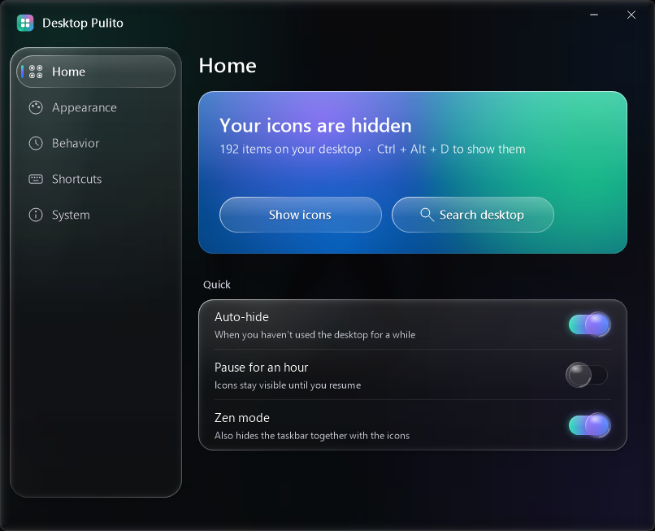
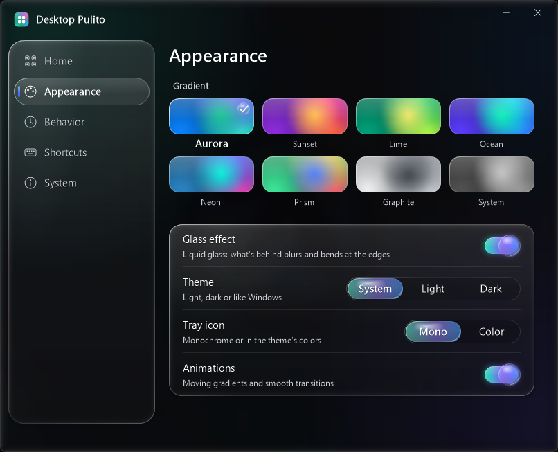
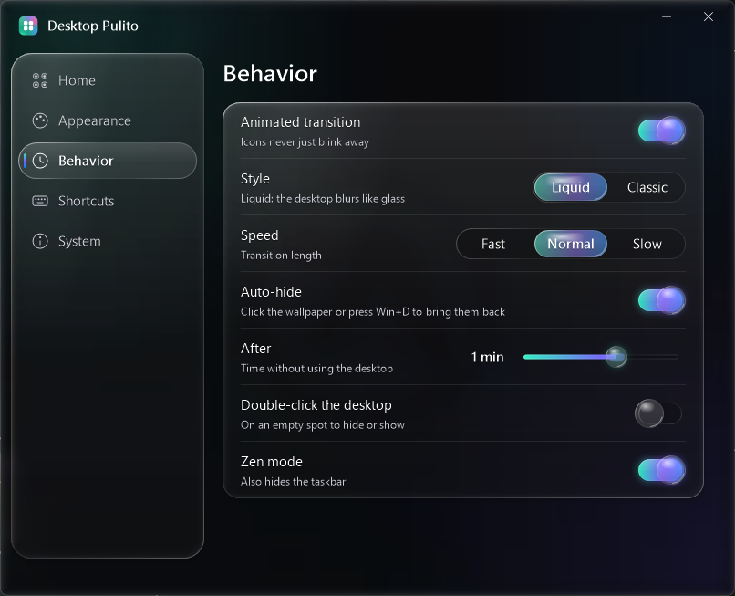

<div align="center">


# Desktop Pulito

**A clean desktop in one click — without moving or deleting a single file.**

Hide every desktop icon with a liquid, glass-like transition. Bring them back with a click.
Find anything on your desktop while it stays beautifully empty.

Tiny · Open source · Zero CPU when idle · Windows 10 & 11

[**Download**](../../releases/latest) · [Features](#features) · [How it works](#how-it-works) · [Italiano](#italiano)



</div>

---

## Why

Your desktop is full of things you actually need — shortcuts, projects, downloads.
But you don't need to *look* at them all day. Desktop Pulito hides them, keeps your wallpaper clean,
and gives them back the instant you want them. Nothing is moved, renamed or deleted: it uses the very
same switch as Windows' own *View → Show desktop icons*.

## Features

| | |
|---|---|
| 🫧 **Liquid transition** | The desktop fogs up like glass in smooth steps, icons melt into the blur (or condense out of it), then everything snaps back crisp. Synced to your monitor's refresh rate. |
| ✨ **7 transitions** | Liquid, Fade, Circle (opens from your mouse), Wipe, Gravity (icons fall, then bounce back), Wave (columns cascade from your mouse) and Float. Three speeds and a *Try it* button. All GPU-composited: shapes and moving layers, no per-frame pixel work. |
| 🔍 **Search your desktop** | `Ctrl+Alt+F` opens a glass search bar with every item on your desktop. Type, press Enter, done. Icons stay hidden. Drag it wherever you like — it remembers. |
| ⏱️ **Auto-hide** | Icons hide after a while (5 s – 5 min) and come back when you click the wallpaper or press `Win+D`. Pause it for an hour when you need to. |
| 🧘 **Zen mode** | Hides the taskbar together with the icons. Only your wallpaper remains. |
| ⌨️ **Shortcuts** | `Ctrl+Alt+D` toggles icons from anywhere. Both shortcuts are customizable, with conflict detection. |
| 🖱️ **Double-click** | Optional: double-click an empty spot of the desktop to hide/show. |
| 🎨 **8 gradient themes** | Aurora, Sunset, Lime, Ocean, Neon, Prism, Graphite and System (your Windows accent). Light, dark or automatic. |
| 🪟 **Liquid Glass UI** | A real liquid-glass simulation: what's behind the window is blurred, made more vivid and **bent at every edge like a lens**, with a hint of chromatic aberration and light running along the rim. Glass-bubble switches over glowing tracks, a sliding lens in every selector. Works on Windows 10 too. |
| 🌍 **English & Italiano** | Follows your Windows language automatically. |

<p align="center">
  
  
</p>

## Install

1. Download `DesktopPulito.exe` from the [latest release](../../releases/latest).
2. Run it. The icon appears next to the clock.
3. Optional: turn on **Start with Windows** (System page). The app copies itself to
   `%LOCALAPPDATA%\Programs\DesktopPulito`, so you can delete the downloaded file afterwards.

No installer, no admin rights, no dependencies (uses the .NET Framework already built into Windows).

> Windows SmartScreen may warn you because the executable isn't code-signed. Click **More info → Run anyway**,
> or build it yourself from source (below) in ten seconds.

### Using it

| Action | Result |
|---|---|
| Click the tray icon | Hide / show icons |
| Right-click the tray icon | Quick menu |
| Middle-click the tray icon | Search desktop |
| `Ctrl+Alt+D` | Hide / show icons |
| `Ctrl+Alt+F` | Search desktop |
| Click the wallpaper / `Win+D` | Bring icons back (with auto-hide) |

**Uninstall:** System → *Remove from PC*. It removes autostart, settings and the installed copy, then quits.
Your icons are always restored on exit.

## Performance

Measured on a dual-monitor Windows 11 machine with 190+ desktop items:

| | |
|---|---|
| Executable size | ~190 KB |
| CPU when idle | **0 ms** over 10 s (event-driven, no polling while you work) |
| Memory when idle | < 1 MB working set (released after every animation) |
| Transition start | ~100 ms from click to first frame |
| Smooth blur | ~20 ms (light) + ~7 ms (strong) for a 3840-px-wide dual-monitor desktop, all cores |
| Animation | GPU-composited by DWM, vsync-paced (60/120/144 Hz) |

How it stays this light:

- **No polling.** Windows notifies the app when you switch to the desktop. A 1 s timer runs only while
  icons are visible with auto-hide on; a short click-watch runs only while the desktop is focused and icons are hidden.
- **Animations stop themselves.** Every UI timer shuts down as soon as nothing is moving.
- **Free gradients.** Gradients are painted into a 40-pixel bitmap and upscaled with bilinear filtering.
- **Real blur, fast.** The transition blur is a proper soft filter (block average → repeated box blur → bilinear upscale)
  written with unsafe pointers and `Parallel.For`: no pixelation, a few milliseconds.
- **Heavy work in parallel.** When icons come back, waiting for Explorer, capturing and blurring happen on a
  worker thread while the animation is already running.
- **Windows on demand.** Settings, search and menu are created when opened and disposed when closed.

## How it works

- **Hide/show** sends Explorer's internal *Show desktop icons* command (`0x7402`) to the desktop view
  (`SHELLDLL_DefView`). It is exactly the same toggle as the desktop's context menu — that's why it is safe.
- **Transitions** place a click-through, capture-excluded snapshot of the screen *just above the desktop and
  below your windows*, switch the icons underneath, then cross-fade through two blur levels of the "before" and "after" desktop.
- **Liquid glass** — the window briefly excludes itself from capture (`WDA_EXCLUDEFROMCAPTURE`), grabs what's
  behind it, then blurs it, boosts saturation and tints it. A signed-distance field of every rounded panel drives a
  lens displacement (with per-channel offsets for chromatic aberration) and a rim light. It only runs on open, while
  dragging and every few seconds; in between, painting the glass is a plain pixel copy.
- **Fluid UI** — animations are paced by a frame-clock thread on `DwmFlush` (your real refresh rate) and are
  time-based, only dirty regions are repainted, and glass panels/bubbles are rendered once and cached.

## Build from source

Requirements: Windows 10/11 and the free [.NET 10 SDK](https://dotnet.microsoft.com/download).

```powershell
git clone https://github.com/<your-user>/desktop-pulito.git
cd desktop-pulito
dotnet test DesktopPulito.slnx
dotnet run --project src/DesktopPulito.App
```

Release build (single 1 MB file, needs the free .NET 10 Desktop Runtime):

```powershell
dotnet publish src/DesktopPulito.App -c Release -r win-x64 --self-contained false -p:PublishSingleFile=true -p:PublishReadyToRun=true -o publish
```

Automation: `DesktopPulito.exe /toggle` hides/shows the icons and `DesktopPulito.exe /search` opens the search bar
(handy for Stream Deck, AutoHotkey or scripts). `Ctrl+Alt+S` switches scene.

The code follows **Clean Architecture** — see [docs/ARCHITECTURE.md](docs/ARCHITECTURE.md) and the [roadmap](docs/ROADMAP.md).

```
src/
  DesktopPulito.Domain/          pure rules: settings, transitions, scenes, widgets, search, weather, agenda
  DesktopPulito.Application/     use cases + ports (interfaces)
  DesktopPulito.Infrastructure/  Windows adapters, GPU-composited transitions, JSON storage, Open-Meteo, iCal
  DesktopPulito.App/             liquid-glass UI, tray icon, composition root
tests/DesktopPulito.Tests/       xUnit tests
```
## Privacy

No telemetry, no accounts. The only network calls are the optional free services you turn on (Open-Meteo weather, your own iCal link). Settings live in `%APPDATA%\DesktopPulito\settings.json`.

## Contributing

Issues and pull requests are welcome — bug reports, translations, themes. Please keep the spirit:
small, fast, beautiful.

## License

[MIT](LICENSE)

---

## Italiano

**Desktop Pulito** nasconde tutte le icone del desktop con una transizione liquida e le fa tornare con un clic.
Non sposta né cancella nessun file: usa lo stesso interruttore di Windows *Visualizza → Mostra icone del desktop*.

- **Transizione liquida**: il desktop si sfoca come vetro mentre le icone si sciolgono (e si condensano quando tornano).
- **Cerca sul desktop** con `Ctrl+Alt+F`: apri file e programmi senza mostrare le icone. Il pannello si trascina e ricorda la posizione.
- **Nascondi automaticamente**, **pausa di un'ora**, **modalità Zen** (nasconde anche la barra), **doppio clic** sul desktop.
- **8 temi a gradiente**, vetro vero di Windows 11, tema chiaro/scuro, italiano e inglese.
- **Leggerissimo**: a riposo 0 ms di processore e meno di 1 MB di memoria attiva.

Scarica `DesktopPulito.exe` dalla pagina [Releases](../../releases/latest), avvialo e trovi l'icona vicino all'orologio.
Per compilarlo: `powershell -ExecutionPolicy Bypass -File build.ps1`.
